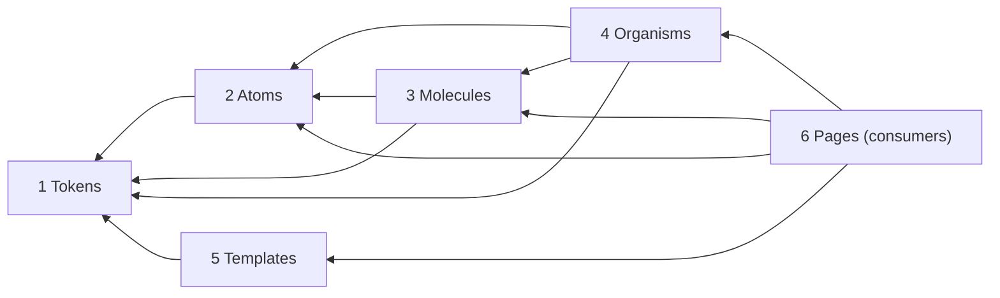

# ASDLC Design System Catalog

Zero-build, Lumen-inspired vanilla Web Components and CSS Custom Property tokens.
Machine-readable source of truth: [`catalog.json`](catalog.json).

## Quick Start (Zero-Build ESM)

Declare `Design-System: asdlc-meta-designsystem@latest` (auto-updating default) or `Design-System: asdlc-meta-designsystem@v0.1.0` (pinned release) in your repository's `TECH_STACK.md`, and import from the matching GitHub Pages channel:

```html
<!-- Unpinned (@latest — updates automatically when asdlc-meta-designsystem main deploys): -->
<link rel="stylesheet" href="https://jvanheerikhuize.github.io/asdlc-meta-designsystem/latest/src/tokens/tokens.css">
<script type="module" src="https://jvanheerikhuize.github.io/asdlc-meta-designsystem/latest/src/index.js"></script>

<!-- Or pinned (@v0.1.0): replace /latest/ with /v0.1.0/ -->

<ui-label for="q" required>Search</ui-label>
<ui-input id="q" aria-label="Search" placeholder="Filter records…"></ui-input>
<ui-button variant="primary"><ui-icon name="search" size="sm"></ui-icon> Run</ui-button>
```

- `ensureTokens(doc = document)` (exported from `src/index.js`) idempotently injects `<link rel="stylesheet" href=".../tokens.css">` if not already present.
- `tokens.css` defines custom properties only and is required, because components have no fallback values; it does not reset `body` styles or bundle `@font-face` files. Load the fonts in the page itself: `<link rel="stylesheet" href="https://fonts.googleapis.com/css2?family=Bricolage+Grotesque:wght@500;600;700;800&family=Geist+Mono:wght@400;500;600&family=Geist:wght@400;500;600;700&display=swap">`.
- **MkDocs Material Adapter (`src/tokens/mkdocs-theme.css`):** For MkDocs Material documentation/wiki sites, include both `.../src/tokens/tokens.css` and `.../src/tokens/mkdocs-theme.css` in `extra_css` (and set `palette` default to `slate`) to bridge `--md-*` theme variables to ASDLC `--color-*` and `--font-*` tokens.
- Theme switching: dark mode is the default on `:root`; set `data-theme="light"` on `<html>` (or an ancestor) for light mode.
- **Shadow DOM Notes:** `<ui-button>` aligns slotted `<ui-icon>` and text with `inline-flex` + `gap` and `<ui-icon>` inherits `currentColor`. `<ui-input>` exposes a live `.value` JS property in addition to `ui-input`/`ui-change` events. `<ui-button>`, `<ui-input>` and `<ui-field>` are form-associated: use them in a `<form>` and listen to `submit`. A `ui-button` is not the event's `submitter`. The other controls are not form-associated, and there is no cross-shadow `<label for>` bridging, so pair `<ui-input>` with `aria-label`. `<ui-skeleton lines>` applies only when `variant="text"`.

## Tier Architecture (`REQ-0001`)

Each arrow means "may use". Lower tiers MUST NOT import or depend on higher tiers.



Templates take components only through slots, so they import none.

| Tier | Purpose | May use | Members |
| :--- | :--- | :--- | :--- |
| 1. Tokens | Named values that nothing renders. The only place for raw colors, lengths, layers and durations. | — | 158 tokens in 16 groups |
| 2. Atoms | One foundational HTML element each, with local state only. | tokens | 17 |
| 3. Molecules | One to three kinds of atom for one task. | tokens, atoms | 11 |
| 4. Organisms | Self-contained regions with their own choreography, such as focus, loading and empty states. | tokens, atoms, molecules | 7 |
| 5. Templates | Content-agnostic skeletons with named slots and responsive placement. | tokens | 4 |
| 6. Pages | Templates filled with real data. They live in consumers, not in the shared package. | tokens, atoms, molecules, organisms, templates | 1 |

## 1. Tokens (`src/tokens/`)

Named values that nothing renders. The only place for raw colors, lengths, layers and durations.

| Group | Tokens | Dark (`:root`) | Light (`[data-theme="light"]`) |
| :--- | :--- | :--- | :--- |
| Canvas & Surfaces | `--color-bg`, `--color-surface`, `--color-surface-elevated`, `--color-card`, `--color-card-hover`, `--color-overlay` | `#08080b`, `#111116`, `#18181f`, `rgba(255,255,255,0.04)`, `0.07`, `rgba(0,0,0,0.75)` | `#fafafa`, `#ffffff`, `#f4f4f5`, `rgba(9,9,11,0.03)`, `0.06`, `rgba(9,9,11,0.55)` |
| Ambient Glow | `--glow-rose`, `--glow-amber` | `rgba(244,63,94,0.08)`, `rgba(251,146,60,0.05)` | `rgba(225,29,72,0.06)`, `rgba(217,119,6,0.04)` |
| Borders & Focus | `--color-border`, `--color-border-hover`, `--color-focus-ring` | `rgba(255,255,255,0.08)`, `0.22`, `#f43f5e` | `rgba(9,9,11,0.10)`, `0.24`, `#e11d48` |
| Foreground Text | `--color-fg`, `--color-fg-secondary`, `--color-fg-muted` | `#ededed`, `#a1a1aa`, `#8e8e98` | `#09090b`, `#52525b`, `#5c5c66` |
| Accents | `--color-accent`, `--color-accent-hover`, `--color-accent-fg`, `--color-info`, `--color-success`, `--color-warning`, `--color-danger`, `--color-danger-fg` | `#f43f5e`, `#fb7185`, `#08080b`, `#38bdf8`, `#10b981`, `#f59e0b`, `#f87171`, `#08080b` | `#e11d48`, `#be123c`, `#ffffff`, `#0369a1`, `#047857`, `#b45309`, `#dc2626`, `#ffffff` |
| Typography | `--font-sans`, `--font-display`, `--font-mono`, `--text-xs`..`--text-2xl`, `--leading-tight`, `--leading-normal` | `Geist`, `Bricolage Grotesque`, `Geist Mono` | same |
| Spacing & Radii | `--space-1`..`--space-12`, `--radius-sm`..`--radius-full` | `0.25rem`..`3rem`, `0.375rem`..`9999px` | same |
| Shadows & Motion | `--shadow-sm`..`--shadow-lg`, `--duration-fast`, `--duration-normal`, `--duration-shimmer`, `--ease-standard` | `120ms`, `220ms`, `1400ms` (`0ms` under `prefers-reduced-motion: reduce`) | lighter alpha shadows |
| Primitives | `--palette-*` | Raw colors for the semantic tokens above. Do not use them directly. | same |
| Type details | `--weight-medium`, `--weight-semibold`, `--weight-bold`, `--leading-none`, `--leading-snug`, `--leading-control`, `--tracking-label` | `500`, `600`, `700`, `1`, `1.15`, `1.25`, `0.02em` | same |
| Borders & focus widths | `--border-width`, `-strong`, `-thumb`, `-accent`, `--focus-width`, `--focus-offset`, `--focus-offset-wide` | `1px`..`4px` | same |
| Sizes | `--control-*`, `--icon-*`, `--size-*`, `--switch-*`, `--pad-*` | see `catalog.json` | same |
| Layout | `--panel-*`, `--layout-*`, `--anchor-gap`, `--anchor-margin` | see `catalog.json` | same |
| Layers | `--z-floating`, `--z-tray`, `--z-panel`, `--z-header`, `--z-tooltip` | `10`, `12`, `15`, `20`, `60` | same |
| Effects | `--opacity-disabled`, `--opacity-muted`, `--frost-sm`, `--frost-md` | `0.55`, `0.7`, `8px`, `12px` | same |

## 2. Atoms (`src/atoms/`)

One foundational HTML element each, with local state only.

| Tag | Composes | Attributes | Slots | Events | Parts |
| :--- | :--- | :--- | :--- | :--- | :--- |
| `<ui-badge>` | — | `variant` (`neutral`\|`accent`\|`info`\|`success`\|`warning`), `size` (`sm`\|`md`) | default | — | `badge` |
| `<ui-button>` | — | `variant` (`primary`\|`secondary`\|`surface`\|`ghost`\|`danger`), `size` (`sm`\|`md`\|`lg`), `disabled`, `busy`, `type`, `aria-label`, `aria-pressed` (`true`\|`false`, controlled by the owner), `aria-expanded`, `aria-haspopup` | default | `ui-press` | `button` |
| `<ui-checkbox>` | — | `checked`, `disabled`, `indeterminate`, `name`, `value`, `aria-label` | default | `ui-change` | `label`, `checkbox` |
| `<ui-chip>` | — | `pressed`, `disabled`, `variant` (`default`\|`accent`) | default | `ui-toggle` | `chip` |
| `<ui-divider>` | — | `orientation` (`horizontal`\|`vertical`) | — | — | `divider` |
| `<ui-dot>` | — | `status` (`done`\|`wait`\|`bad`\|`info`\|`off`), `label` | — | — | `dot` |
| `<ui-icon>` | — | `name` (`search`, `sun`, `moon`, `check`, `alert`, `info`, `arrow-right`, `arrow-left`, `sparkles`, `code`, `layers`, `external`, `plus`, `minus`, `close`, `undo`, `redo`, `trash`, `download`, `upload`, `route`, `compass`, `pin`, `flag`, `anchor`, `waves`, `scissors`, `settings`, `chevron-down`, `chevron-up`, `eye`, `eye-off`, `sidebar`), `size` (`sm`\|`md`\|`lg`), `label` | — | — | `icon` |
| `<ui-input>` | — | `type`, `value`, `placeholder`, `disabled`, `readonly`, `required`, `invalid`, `name`, `maxlength`, `aria-label` | — | `ui-input`, `ui-change` | `input` |
| `<ui-label>` | — | `for`, `required`, `size` (`md`\|`sm`) | default | — | `label` |
| `<ui-progress>` | — | `value`, `max`, `variant` (`success`\|`accent`\|`warning`\|`danger`), `segments` (JSON), `aria-label` | — | — | `track`, `fill`, `segment` |
| `<ui-select>` | — | `options` (JSON array), `value`, `disabled`, `invalid`, `name`, `aria-label` | — | `ui-change` | `wrapper`, `select`, `chevron` |
| `<ui-skeleton>` | — | `variant` (`text`\|`rect`\|`circle`), `width`, `height`, `lines` | — | — | `skeleton` |
| `<ui-slider>` | — | `min`, `max`, `step`, `value`, `disabled`, `variant` (`accent`\|`success`\|`warning`\|`neutral`), `name`, `aria-label`, `aria-valuetext` | — | `ui-input`, `ui-change` | `track`, `slider` |
| `<ui-surface>` | — | `variant` (`base`\|`elevated`\|`card`\|`glass`), `elevation`, `padding`, `radius`, `accent`, `interactive` | default | `ui-press` | `surface` |
| `<ui-switch>` | — | `checked`, `disabled`, `size` (`sm`\|`md`), `name`, `value`, `aria-label` | default | `ui-change` | `label`, `switch`, `thumb` |
| `<ui-textarea>` | — | `value`, `placeholder`, `rows`, `disabled`, `readonly`, `required`, `invalid`, `name`, `aria-label` | — | `ui-input`, `ui-change` | `textarea` |
| `<ui-tooltip>` | — | `text`, `placement` (`top`\|`bottom`\|`left`\|`right`), `open` | default | — | `tooltip` |

## 3. Molecules (`src/molecules/`)

One to three kinds of atom for one task.

| Tag | Composes | Attributes | Slots | Events | Parts |
| :--- | :--- | :--- | :--- | :--- | :--- |
| `<ui-callout>` | `ui-button`, `ui-icon`, `ui-surface` | `variant` (`info`\|`success`\|`warning`\|`danger`), `title`, `dismissible`, `close-label` | default | `ui-close` | `callout`, `icon`, `title`, `body`, `close` |
| `<ui-code-block>` | `ui-button`, `ui-icon`, `ui-surface` | `language` | default | `ui-copy` | `container`, `header`, `language`, `copy-button`, `pre` |
| `<ui-empty-state>` | `ui-icon`, `ui-surface` | `text`, `icon` | default | — | `container`, `body`, `text` |
| `<ui-field>` | `ui-input`, `ui-label` | `label`, `name`, `value`, `placeholder`, `type`, `required`, `invalid`, `disabled`, `hint`, `error` | — | `ui-input`, `ui-change` | `label`, `input`, `hint` |
| `<ui-media-card>` | `ui-badge`, `ui-icon`, `ui-surface` | `card-id`, `title`, `subtitle`, `badge`, `badge-variant`, `meta` | default | `ui-select` | `card`, `badge`, `title`, `subtitle`, `meta` |
| `<ui-panel-header>` | `ui-button`, `ui-icon` | `title`, `heading-id`, `close-label` | `actions` | `ui-close` | `header`, `title`, `close` |
| `<ui-search-bar>` | `ui-button`, `ui-icon`, `ui-input` | `value`, `placeholder`, `button-label`, `aria-label`, `disabled`, `clearable`, `clear-label`, `compact` | — | `ui-search`, `ui-input` | `bar`, `input`, `button`, `clear` |
| `<ui-stat-tile>` | `ui-dot`, `ui-surface` | `value`, `label`, `status`, `variant` (`neutral`\|`accent`\|`success`\|`warning`\|`danger`) | — | — | `tile`, `value`, `dot`, `label` |
| `<ui-tabs>` | `ui-button`, `ui-surface` | `tabs` (JSON array), `value`, `full-width`, `aria-label` | default, `<tab-id>` | `ui-change` | `tablist`, `tab`, `panel` |
| `<ui-theme-toggle>` | `ui-button`, `ui-icon` | `theme` (`dark`\|`light`) | — | `ui-theme-change` | `theme-button` |
| `<ui-toolbar>` | `ui-surface` | `orientation` (`horizontal`\|`vertical`), `variant` (`inline`\|`floating`), `aria-label`, `aria-controls` | default | `ui-navigate` | `toolbar` |

## 4. Organisms (`src/organisms/`)

Self-contained regions with their own choreography, such as focus, loading and empty states.

| Tag | Composes | Attributes | Slots | Events | Parts |
| :--- | :--- | :--- | :--- | :--- | :--- |
| `<ui-catalog-grid>` | `ui-empty-state`, `ui-skeleton` | `loading`, `empty`, `empty-text` | default | — | `skeletons`, `grid`, `empty` |
| `<ui-drawer>` | `ui-divider`, `ui-panel-header`, `ui-surface` | `title`, `side` (`left`\|`right`\|`bottom`), `mode` (`docked`\|`modal`\|`auto`), `open` | default, `footer` | `ui-open`, `ui-close` | `panel`, `dialog`, `sheet`, `header`, `title`, `close`, `body`, `footer` |
| `<ui-modal>` | `ui-divider`, `ui-panel-header`, `ui-surface` | `title`, `open` | default, `footer` | `ui-open`, `ui-close` | `dialog`, `title`, `close`, `body`, `footer` |
| `<ui-navbar>` | `ui-surface`, `ui-theme-toggle` | `theme` (`dark`\|`light`) | `brand`, `nav`, `search`, `actions` | `ui-theme-change` | `header`, `theme-button` |
| `<ui-popover>` | `ui-surface` | `open`, `placement` (`bottom-start`\|`bottom-end`\|`top-start`\|`top-end`), `aria-label` | `trigger`, default | `ui-open`, `ui-close` | `trigger`, `panel` |
| `<ui-table>` | `ui-empty-state`, `ui-skeleton` | `aria-label`, `loading`, `empty`, `empty-text` | default (native `<table>`) | — | `scroll`, `skeleton`, `empty` |
| `<ui-toast>` | `ui-callout` | `variant` (`info`\|`success`\|`warning`\|`danger`), `title`, `open`, `duration` | default | `ui-close` | `callout` |

## 5. Templates (`src/templates/`)

Content-agnostic skeletons with named slots and responsive placement.

| Tag | Composes | Attributes | Slots | Events | Parts |
| :--- | :--- | :--- | :--- | :--- | :--- |
| `<catalog-layout>` | — | — | `hero`, `toolbar`, `grid`, `modal` | — | `hero`, `toolbar`, `grid` |
| `<detail-layout>` | — | — | default, `aside` | — | `grid`, `main`, `aside` |
| `<page-shell>` | — | — | `header`, default, `footer` | — | `main`, `footer` |
| `<workspace-layout>` | — | `aside-side` (`left`\|`right`) | `header`, `aside`, default, `floating`, `bottom` | — | `header`, `body`, `aside`, `main`, `canvas`, `floating`, `bottom` |

## 6. Pages (`showcase/`)

Templates filled with real data. They live in consumers, not in the shared package.

| Page | Templates | Where |
| :--- | :--- | :--- |
| Showcase | `<catalog-layout>`, `<page-shell>` | [`showcase/index.html`](showcase/index.html) ([live](https://jvanheerikhuize.github.io/asdlc-meta-designsystem/)) |

To build a page in a consumer, pick a template, fill its slots with organisms, molecules and atoms, and supply the data, state and routing there.
