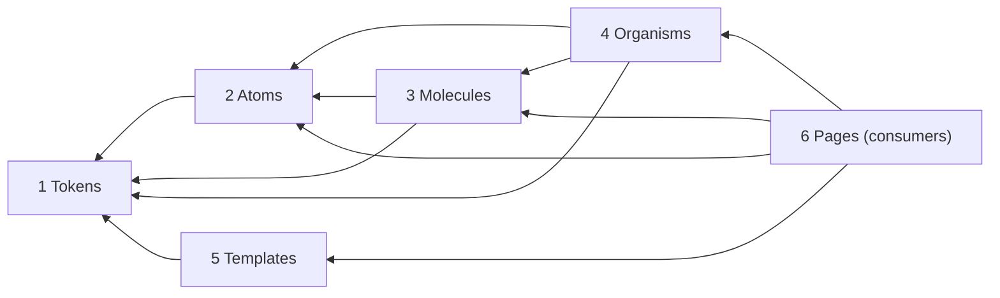

# ASDLC Design System Catalog

Zero-build, Lumen-inspired vanilla Web Components and CSS Custom Property tokens.
Machine-readable source of truth: [`catalog.json`](catalog.json).

## Quick Start (Zero-Build ESM)

Declare `Design-System: asdlc-meta-designsystem@latest` (auto-updating default) or `Design-System: asdlc-meta-designsystem@v0.1.0` (pinned release) in your repository's `TECH_STACK.md`, and import from the matching GitHub Pages channel:

```html
<!-- Unpinned (@latest — updates automatically when asdlc-meta-designsystem main deploys): -->
<link rel="stylesheet" href="https://jvanheerikhuize.github.io/asdlc-meta-designsystem/latest/src/tokens/tokens.css">
<script type="module" src="https://jvanheerikhuize.github.io/asdlc-meta-designsystem/latest/src/index.js"></script>

<!-- Or pinned (@v0.1.0): replace /latest/ with /v0.1.0/ -->

<ui-label for="q" required>Search</ui-label>
<ui-input id="q" aria-label="Search" placeholder="Filter records…"></ui-input>
<ui-button variant="primary"><ui-icon name="search" size="sm"></ui-icon> Run</ui-button>
```

- `ensureTokens(doc = document)` (exported from `src/index.js`) idempotently injects `<link rel="stylesheet" href=".../tokens.css">` if not already present.
- `tokens.css` defines custom properties only and is required, because components have no fallback values; it does not reset `body` styles or bundle `@font-face` files. Load the fonts in the page itself: `<link rel="stylesheet" href="https://fonts.googleapis.com/css2?family=Bricolage+Grotesque:wght@500;600;700;800&family=Geist+Mono:wght@400;500;600&family=Geist:wght@400;500;600;700&display=swap">`.
- **MkDocs Material Adapter (`src/tokens/mkdocs-theme.css`):** For MkDocs Material documentation/wiki sites, include both `.../src/tokens/tokens.css` and `.../src/tokens/mkdocs-theme.css` in `extra_css` (and set `palette` default to `slate`) to bridge `--md-*` theme variables to ASDLC `--color-*` and `--font-*` tokens.
- Theme switching: dark mode is the default on `:root`; set `data-theme="light"` on `<html>` (or an ancestor) for light mode.
- **Shadow DOM Notes:** `<ui-button>` aligns slotted `<ui-icon>` and text with `inline-flex` + `gap` and `<ui-icon>` inherits `currentColor`. `<ui-input>` exposes a live `.value` JS property in addition to `ui-input`/`ui-change` events. `<ui-button>`, `<ui-input>` and `<ui-field>` are form-associated: use them in a `<form>` and listen to `submit`. A `ui-button` is not the event's `submitter`. The other controls are not form-associated, and there is no cross-shadow `<label for>` bridging, so pair `<ui-input>` with `aria-label`. `<ui-skeleton lines>` applies only when `variant="text"`.

## Tier Architecture (`REQ-0001`)

Each arrow means "may use". Lower tiers MUST NOT import or depend on higher tiers.



Templates take components only through slots, so they import none.

| Tier | Purpose | May use | Members |
| :--- | :--- | :--- | :--- |
| 1. Tokens | Named values that nothing renders. The only place for raw colors, lengths, layers and durations. | — | 741 tokens in 28 groups |
| 2. Atoms | One foundational HTML element each, with local state only. | tokens | 67 |
| 3. Molecules | At most three kinds of atom, not counting text atoms, for one task. | tokens, atoms | 11 |
| 4. Organisms | Self-contained regions with their own choreography, such as focus, loading and empty states. | tokens, atoms, molecules | 7 |
| 5. Templates | Content-agnostic skeletons with named slots and responsive placement. | tokens | 4 |
| 6. Pages | Templates filled with real data. They live in consumers, not in the shared package. | tokens, atoms, molecules, organisms, templates | 1 |

## 1. Tokens (`src/tokens/`)

Named values that nothing renders. The only place for raw colors, lengths, layers and durations.

Values for both themes and the role of each token are in `catalog.json`. Use the semantic groups; `--palette-*` is only for them.

| Group | Use | Tokens |
| :--- | :--- | :--- |
| Primitive palette | Raw colors. Only semantic tokens may use them. | `--palette-zinc-50`..`950`, `--palette-red-50`..`950`, `--palette-orange-50`..`950`, `--palette-amber-50`..`950`, `--palette-lime-50`..`950`, `--palette-emerald-50`..`950`, `--palette-teal-50`..`950`, `--palette-sky-50`..`950`, `--palette-indigo-50`..`950`, `--palette-violet-50`..`950`, `--palette-pink-50`..`950`, `--palette-rose-50`..`950`, plus `--palette-{ink,paper,white,black}*` and `-aNN` alpha variants |
| Canvas and surfaces | Page and panel backgrounds. | `--color-bg`, `--color-surface`, `--color-surface-elevated`, `--color-card`, `--color-card-hover`, `--color-overlay`, `--color-bg-subtle`, `--color-surface-sunken`, `--color-surface-raised`, `--color-surface-inverse`, `--color-card-active`, `--color-selected`, `--color-drop-target`, `--color-scrim-soft`, `--color-glass`, `--color-skeleton`, `--color-surface-glass` |
| Ambient glow | Page background highlights. | `--glow-rose`, `--glow-amber`, `--glow-sky`, `--glow-emerald`, `--glow-violet` |
| Borders and focus | Hairlines and the focus ring. | `--color-border`, `--color-border-hover`, `--color-focus-ring`, `--color-border-subtle`, `--color-border-strong`, `--color-border-control`, `--color-border-disabled`, `--color-border-inverse`, `--color-border-selected`, `--color-divider`, `--color-border-field` |
| Foreground | Text colors by importance. | `--color-fg`, `--color-fg-secondary`, `--color-fg-muted`, `--color-fg-disabled`, `--color-fg-placeholder`, `--color-fg-inverse`, `--color-fg-on-media`, `--color-icon`, `--color-icon-muted`, `--color-link`, `--color-link-hover`, `--color-link-visited`, `--color-heading`, `--color-caret`, `--color-selection`, `--color-highlight`, `--color-match-active`, `--color-match-active-fg` |
| Accents | Brand and status colors. | `--color-accent`, `--color-accent-hover`, `--color-accent-fg`, `--color-info`, `--color-success`, `--color-warning`, `--color-danger`, `--color-danger-fg`, `--color-thumb` |
| Status states | Hover, pressed, tint, border and text for each status and for the accent. | `--color-info-hover`, `--color-info-active`, `--color-info-fg`, `--color-info-subtle`, `--color-info-subtle-hover`, `--color-info-border`, `--color-info-text`, `--color-success-hover`, `--color-success-active`, `--color-success-fg`, `--color-success-subtle`, `--color-success-subtle-hover`, `--color-success-border`, `--color-success-text`, `--color-warning-hover`, `--color-warning-active`, `--color-warning-fg`, `--color-warning-subtle`, `--color-warning-subtle-hover`, `--color-warning-border`, `--color-warning-text`, `--color-danger-hover`, `--color-danger-active`, `--color-danger-subtle`, `--color-danger-subtle-hover`, `--color-danger-border`, `--color-danger-text`, `--color-accent-active`, `--color-accent-subtle`, `--color-accent-subtle-hover`, `--color-accent-border`, `--color-accent-text`, `--color-neutral`, `--color-neutral-hover`, `--color-neutral-active`, `--color-neutral-fg`, `--color-neutral-subtle`, `--color-neutral-subtle-hover`, `--color-neutral-border`, `--color-neutral-text`, `--color-accent-pressed`, `--color-accent-pressed-hover`, `--color-accent-pressed-border` |
| Data series | Categorical, sequential and diverging colors for charts and maps. | `--color-data-1`, `--color-data-2`, `--color-data-3`, `--color-data-4`, `--color-data-5`, `--color-data-6`, `--color-data-7`, `--color-data-8`, `--color-data-9`, `--color-data-10`, `--color-data-seq-1`, `--color-data-seq-2`, `--color-data-seq-3`, `--color-data-seq-4`, `--color-data-seq-5`, `--color-data-seq-6`, `--color-data-seq-7`, `--color-data-div-neg-strong`, `--color-data-div-neg`, `--color-data-div-mid`, `--color-data-div-pos`, `--color-data-div-pos-strong`, `--color-data-grid`, `--color-data-axis`, `--color-data-missing`, `--color-data-positive`, `--color-data-negative` |
| Code | Syntax and diff colors. | `--color-code-bg`, `--color-code-fg`, `--color-code-comment`, `--color-code-keyword`, `--color-code-string`, `--color-code-number`, `--color-code-function`, `--color-code-type`, `--color-code-variable`, `--color-code-operator`, `--color-code-tag`, `--color-code-attribute`, `--color-code-inserted`, `--color-code-inserted-bg`, `--color-code-deleted`, `--color-code-deleted-bg`, `--color-code-line-active`, `--color-code-gutter` |
| Gradients | Background images made from themed colors. | `--gradient-accent`, `--gradient-cool`, `--gradient-surface`, `--gradient-fade-up`, `--gradient-fade-down`, `--gradient-media-scrim`, `--gradient-shimmer`, `--gradient-ambient`, `--gradient-data-seq`, `--gradient-data-div` |
| Typography | Font stacks, sizes, weights, line heights and tracking. | `--font-sans`, `--font-display`, `--font-mono`, `--text-xs`, `--text-sm`, `--text-md`, `--text-lg`, `--text-xl`, `--text-2xl`, `--leading-tight`, `--leading-normal`, `--weight-medium`, `--weight-semibold`, `--weight-bold`, `--leading-none`, `--leading-snug`, `--leading-control`, `--tracking-label`, `--font-serif`, `--font-emoji`, `--text-2xs`, `--text-3xl`, `--text-4xl`, `--text-5xl`, `--text-6xl`, `--text-fluid-lg`, `--text-fluid-xl`, `--text-fluid-2xl`, `--text-fluid-3xl`, `--weight-light`, `--weight-regular`, `--weight-extrabold`, `--weight-black`, `--leading-relaxed`, `--leading-loose`, `--tracking-display`, `--tracking-heading`, `--tracking-body`, `--tracking-caps`, `--numeric-tabular`, `--numeric-proportional`, `--numeric-slashed`, `--measure-narrow`, `--measure-prose`, `--measure-wide`, `--underline-offset`, `--underline-thickness` |
| Text styles | Complete values for the font property. | `--type-display`, `--type-h1`, `--type-h2`, `--type-h3`, `--type-h4`, `--type-h5`, `--type-lead`, `--type-body`, `--type-body-strong`, `--type-small`, `--type-small-strong`, `--type-label`, `--type-button`, `--type-caption`, `--type-overline`, `--type-code`, `--type-code-small`, `--type-stat`, `--type-quote` |
| Spacing | Gaps and padding. | `--space-1`, `--space-2`, `--space-3`, `--space-4`, `--space-5`, `--space-6`, `--space-8`, `--space-10`, `--space-12`, `--space-0-5`, `--space-0`, `--space-px`, `--space-1-5`, `--space-2-5`, `--space-3-5`, `--space-7`, `--space-9`, `--space-14`, `--space-16`, `--space-20`, `--space-24`, `--space-32`, `--space-40`, `--space-fluid-sm`, `--space-fluid-md`, `--space-fluid-lg`, `--space-fluid-xl` |
| Spacing roles | Spacing by purpose. Prefer these in pages. | `--inset-xs`, `--inset-sm`, `--inset-md`, `--inset-lg`, `--inset-xl`, `--stack-xs`, `--stack-sm`, `--stack-md`, `--stack-lg`, `--stack-xl`, `--cluster-xs`, `--cluster-sm`, `--cluster-md`, `--cluster-lg`, `--gutter`, `--section-gap` |
| Radii | Corner rounding. | `--radius-sm`, `--radius-md`, `--radius-lg`, `--radius-xl`, `--radius-full`, `--radius-xs`, `--radius-none`, `--radius-2xl`, `--radius-3xl`, `--radius-control`, `--radius-card`, `--radius-panel`, `--radius-tag` |
| Border and focus widths | Line thickness and focus offset. | `--border-width`, `--border-width-strong`, `--border-width-thumb`, `--border-width-accent`, `--focus-width`, `--focus-offset`, `--focus-offset-wide`, `--border-width-none`, `--border-width-hairline`, `--focus-offset-inset` |
| Lines | Complete values for the border and outline properties. | `--line-default`, `--line-subtle`, `--line-strong`, `--line-dashed`, `--line-selected`, `--line-accent`, `--line-invalid`, `--line-focus` |
| Shadows | Elevation. | `--shadow-sm`, `--shadow-md`, `--shadow-lg`, `--shadow-thumb`, `--shadow-none`, `--shadow-xs`, `--shadow-xl`, `--shadow-2xl`, `--shadow-inset`, `--shadow-edge`, `--shadow-up`, `--shadow-text`, `--shadow-ring`, `--shadow-glow-accent` |
| Motion | Durations, delays, easing, travel and scale. Movement stops with reduced motion. | `--duration-fast`, `--duration-normal`, `--duration-shimmer`, `--ease-standard`, `--duration-spin`, `--duration-instant`, `--duration-faster`, `--duration-moderate`, `--duration-slow`, `--duration-slower`, `--duration-pulse`, `--delay-tooltip`, `--delay-stagger`, `--delay-toast`, `--delay-type`, `--ease-linear`, `--ease-enter`, `--ease-exit`, `--ease-emphasized`, `--ease-spring`, `--ease-anticipate`, `--travel-xs`, `--travel-sm`, `--travel-md`, `--travel-lg`, `--travel-xl`, `--scale-press`, `--scale-hover`, `--scale-enter`, `--scale-pop` |
| Transitions | Complete values for the transition property. | `--transition-colors`, `--transition-opacity`, `--transition-transform`, `--transition-shadow`, `--transition-enter`, `--transition-exit` |
| Control sizes | Heights, icons and parts of controls. | `--control-sm`, `--control-md`, `--control-lg`, `--icon-sm`, `--icon-md`, `--icon-lg`, `--size-dot`, `--size-checkbox`, `--size-checkmark`, `--size-track`, `--size-thumb`, `--size-thumb-sm`, `--size-skeleton`, `--size-skeleton-card`, `--switch-width`, `--switch-height`, `--switch-travel`, `--switch-width-sm`, `--switch-height-sm`, `--switch-travel-sm`, `--pad-badge-sm`, `--pad-badge-md`, `--pad-chip`, `--control-xs`, `--control-xl`, `--icon-xs`, `--icon-xl`, `--icon-2xl`, `--icon-stroke`, `--size-avatar-xs`, `--size-avatar-sm`, `--size-avatar-md`, `--size-avatar-lg`, `--size-avatar-xl`, `--size-thumbnail-sm`, `--size-thumbnail-md`, `--size-thumbnail-lg`, `--size-dot-sm`, `--size-dot-lg`, `--size-track-lg`, `--size-scrollbar`, `--size-spinner`, `--size-handle`, `--size-marker`, `--size-textarea-min`, `--size-chart-sm`, `--size-chart-md`, `--size-chart-lg`, `--target-min`, `--target-touch`, `--pad-control-sm`, `--pad-control-md`, `--pad-control-lg`, `--pad-cell`, `--size-spinner-inline` |
| Layout | Panel and content sizes. | `--panel-menu-min`, `--panel-tray`, `--panel-tooltip`, `--panel-sheet`, `--panel-menu`, `--panel-drawer`, `--panel-toast`, `--panel-modal`, `--layout-search-min`, `--layout-search-max`, `--layout-aside`, `--layout-card-min`, `--layout-content`, `--anchor-gap`, `--anchor-margin`, `--panel-menu-max`, `--panel-nav`, `--panel-nav-rail`, `--panel-modal-sm`, `--panel-modal-lg`, `--panel-modal-xl`, `--panel-command`, `--layout-xs`, `--layout-sm`, `--layout-md`, `--layout-lg`, `--layout-xl`, `--layout-2xl`, `--layout-full`, `--layout-header`, `--layout-footer`, `--layout-toolbar`, `--layout-column-min`, `--layout-form`, `--layout-columns`, `--viewport-height`, `--viewport-height-small`, `--viewport-height-large` |
| Breakpoints | For scripts and documentation. Media and container queries cannot read them. | `--bp-xs`, `--bp-sm`, `--bp-md`, `--bp-lg`, `--bp-xl`, `--bp-2xl` |
| Aspect ratios | Complete values for the aspect-ratio property. | `--ratio-square`, `--ratio-photo`, `--ratio-classic`, `--ratio-video`, `--ratio-wide`, `--ratio-poster`, `--ratio-portrait`, `--ratio-story`, `--ratio-golden`, `--ratio-banner` |
| Layers | Stacking order. | `--z-floating`, `--z-tray`, `--z-panel`, `--z-header`, `--z-tooltip`, `--z-behind`, `--z-base`, `--z-raised`, `--z-sticky`, `--z-dropdown`, `--z-overlay`, `--z-modal`, `--z-popover`, `--z-toast`, `--z-max` |
| Effects | Opacity and blur. | `--opacity-disabled`, `--opacity-muted`, `--frost-sm`, `--frost-md`, `--opacity-transparent`, `--opacity-faint`, `--opacity-subtle`, `--opacity-half`, `--opacity-strong`, `--opacity-opaque`, `--opacity-drag`, `--frost-none`, `--frost-lg`, `--frost-xl`, `--filter-mute`, `--filter-dim`, `--filter-vivid`, `--filter-mono`, `--filter-glass` |
| Interaction | Cursors and touch behavior. | `--cursor-interactive`, `--cursor-disabled`, `--cursor-busy`, `--cursor-grab`, `--cursor-grabbing`, `--cursor-resize-x`, `--cursor-resize-y`, `--cursor-text`, `--cursor-help`, `--cursor-crosshair`, `--cursor-zoom`, `--touch-pan`, `--touch-none`, `--touch-tap` |
| Safe areas | Space taken by notches and system bars. | `--safe-top`, `--safe-right`, `--safe-bottom`, `--safe-left` |

## 2. Atoms (`src/atoms/`)

One foundational HTML element each, with local state only.

| Tag | Composes | Attributes | Slots | Events | Parts |
| :--- | :--- | :--- | :--- | :--- | :--- |
| `<ui-abbr>` | — | `full` | default | — | `abbr` |
| `<ui-arrow>` | — | `direction` (`up`\|`down`\|`left`\|`right`), `tone` (`surface`\|`inverse`\|`accent`) | — | — | `arrow` |
| `<ui-audio>` | — | `src`, `captions`, `captions-lang`, `loop`, `muted`, `aria-label` | — | — | `audio` |
| `<ui-avatar>` | — | `src`, `name`, `size` (`xs`\|`sm`\|`md`\|`lg`\|`xl`), `shape` (`round`\|`square`) | — | — | `avatar`, `image`, `initials` |
| `<ui-badge>` | — | `variant` (`neutral`\|`accent`\|`info`\|`success`\|`warning`), `size` (`sm`\|`md`) | default | — | `badge` |
| `<ui-button>` | — | `variant` (`primary`\|`secondary`\|`surface`\|`ghost`\|`danger`), `size` (`sm`\|`md`\|`lg`), `disabled`, `busy`, `type`, `aria-label`, `aria-pressed` (`true`\|`false`, controlled by the owner), `aria-expanded`, `aria-haspopup` | default | `ui-press` | `button` |
| `<ui-center>` | — | `width` (`prose`\|`form`\|`content`\|`full`) | default | — | `center` |
| `<ui-checkbox>` | — | `checked`, `disabled`, `indeterminate`, `name`, `value`, `aria-label` | default | `ui-change` | `label`, `checkbox` |
| `<ui-chip>` | — | `pressed`, `disabled`, `variant` (`default`\|`accent`) | default | `ui-toggle` | `chip` |
| `<ui-cluster>` | — | `gap` (`none`\|`xs`\|`sm`\|`md`\|`lg`), `justify` (`start`\|`center`\|`end`\|`between`), `align` (`center`\|`start`\|`end`\|`baseline`), `nowrap` | default | — | `cluster` |
| `<ui-code>` | — | `tone` (`default`\|`accent`), `variant` (`inline`\|`block`) | default | — | `code` |
| `<ui-color-input>` | — | `value`, `disabled`, `name`, `aria-label` | — | `ui-input`, `ui-change` | `input` |
| `<ui-counter>` | — | `value`, `max`, `label`, `variant` (`accent`\|`neutral`\|`danger`), `show-zero` | — | — | `counter` |
| `<ui-disclosure>` | — | `summary`, `open` | default | `ui-toggle` | `details`, `summary`, `body` |
| `<ui-divider>` | — | `orientation` (`horizontal`\|`vertical`) | — | — | `divider` |
| `<ui-dot>` | — | `status` (`done`\|`wait`\|`bad`\|`info`\|`off`), `label` | — | — | `dot` |
| `<ui-embed>` | — | `src`, `label`, `sandbox`, `ratio` (`square`\|`photo`\|`classic`\|`video`\|`wide`\|`poster`\|`portrait`) | — | — | `frame`, `embed` |
| `<ui-fieldset>` | — | `legend`, `kind` (`group`\|`radio`) | default | — | `fieldset`, `legend` |
| `<ui-file-input>` | — | `accept`, `multiple`, `disabled`, `required`, `name`, `aria-label` | — | `ui-change` | `input` |
| `<ui-glow>` | — | `tone` (`rose`\|`amber`\|`sky`\|`emerald`\|`violet`) | — | — | `glow` |
| `<ui-grid>` | — | `min` (`xs`\|`sm`\|`md`\|`lg`), `gap` (`none`\|`xs`\|`sm`\|`md`\|`lg`\|`xl`) | default | — | `grid` |
| `<ui-handle>` | — | `orientation` (`vertical`\|`horizontal`), `value`, `min`, `max`, `disabled`, `aria-label` | — | `ui-move` | `handle` |
| `<ui-heading>` | — | `level` (`1`\|`2`\|`3`\|`4`\|`5`\|`6`), `size` (`display`\|`h1`\|`h2`\|`h3`\|`h4`\|`h5`), `tone` (`default`\|`secondary`\|`muted`\|`accent`\|`info`\|`success`\|`warning`\|`danger`\|`inverse`) | default | — | `heading` |
| `<ui-hint>` | — | `tone` (`neutral`\|`error`\|`success`\|`warning`) | default | — | `hint` |
| `<ui-icon>` | — | `name` (`search`, `sun`, `moon`, `check`, `alert`, `info`, `arrow-right`, `arrow-left`, `sparkles`, `code`, `layers`, `external`, `plus`, `minus`, `close`, `undo`, `redo`, `trash`, `download`, `upload`, `route`, `compass`, `pin`, `flag`, `anchor`, `waves`, `scissors`, `settings`, `chevron-down`, `chevron-up`, `eye`, `eye-off`, `sidebar`), `size` (`sm`\|`md`\|`lg`), `label` | — | — | `icon` |
| `<ui-image>` | — | `src`, `alt`, `ratio` (`square`\|`photo`\|`classic`\|`video`\|`wide`\|`poster`\|`portrait`), `fit` (`cover`\|`contain`), `radius` (`none`\|`sm`\|`md`\|`lg`), `loading` (`lazy`\|`eager`) | — | — | `frame`, `image`, `fallback` |
| `<ui-input>` | — | `type`, `value`, `placeholder`, `disabled`, `readonly`, `required`, `invalid`, `name`, `maxlength`, `aria-label` | — | `ui-input`, `ui-change` | `input` |
| `<ui-kbd>` | — | `size` (`sm`\|`md`) | default | — | `key` |
| `<ui-label>` | — | `for`, `required`, `size` (`md`\|`sm`) | default | — | `label` |
| `<ui-link>` | — | `href`, `target`, `rel`, `download`, `aria-label`, `variant` (`inline`\|`quiet`\|`standalone`) | default | — | `link` |
| `<ui-list>` | — | `type` (`bullet`\|`number`\|`none`), `gap` (`xs`\|`sm`\|`md`) | default (native <li>) | — | `list` |
| `<ui-live>` | — | `assertive` | — | — | `live` |
| `<ui-mark>` | — | `active` | default | — | `mark` |
| `<ui-marker>` | — | `label`, `variant` (`accent`\|`info`\|`success`\|`warning`\|`danger`\|`neutral`), `selected` | default | — | `marker` |
| `<ui-menu-item>` | — | `disabled`, `variant` (`default`\|`danger`), `checked` (`true`\|`false`) | default | `ui-press` | `item` |
| `<ui-meter>` | — | `value`, `min`, `max`, `low`, `high`, `variant` (`accent`\|`auto`), `aria-label` | — | — | `track`, `fill` |
| `<ui-nav-link>` | — | `href`, `current`, `aria-label` | default | — | `link` |
| `<ui-number>` | — | `value`, `format` (`decimal`\|`percent`\|`currency`\|`unit`\|`compact`), `currency`, `unit`, `digits`, `locale` | — | — | `number` |
| `<ui-number-input>` | — | `value`, `min`, `max`, `step`, `placeholder`, `disabled`, `readonly`, `required`, `invalid`, `name`, `aria-label` | — | `ui-input`, `ui-change` | `input` |
| `<ui-output>` | — | `variant` (`inline`\|`stat`) | default | — | `output` |
| `<ui-progress>` | — | `value`, `max`, `variant` (`success`\|`accent`\|`warning`\|`danger`), `segments` (JSON), `aria-label` | — | — | `track`, `fill`, `segment` |
| `<ui-quote>` | — | `cite`, `source` | default | — | `quote`, `source` |
| `<ui-radio>` | — | `checked`, `disabled`, `name`, `value`, `aria-label` | default | `ui-change` | `label`, `radio` |
| `<ui-rating>` | — | `value`, `max`, `readonly`, `disabled`, `name`, `aria-label` | — | `ui-input`, `ui-change` | `rating` |
| `<ui-ratio>` | — | `ratio` (`square`\|`photo`\|`classic`\|`video`\|`wide`\|`poster`\|`portrait`) | default | — | `frame` |
| `<ui-ring>` | — | `value`, `max`, `size` (`sm`\|`md`\|`lg`), `variant` (`accent`\|`success`\|`warning`\|`danger`), `aria-label` | — | — | `ring` |
| `<ui-scrim>` | — | `tone` (`default`\|`soft`\|`media`), `contained` | — | — | `scrim` |
| `<ui-scroll>` | — | `axis` (`y`\|`x`\|`both`), `aria-label` | default | — | `scroll` |
| `<ui-select>` | — | `options` (JSON array), `value`, `disabled`, `invalid`, `name`, `aria-label` | — | `ui-change` | `wrapper`, `select`, `chevron` |
| `<ui-skeleton>` | — | `variant` (`text`\|`rect`\|`circle`), `width`, `height`, `lines` | — | — | `skeleton` |
| `<ui-skip-link>` | — | `target` | default | — | `link` |
| `<ui-slider>` | — | `min`, `max`, `step`, `value`, `disabled`, `variant` (`accent`\|`success`\|`warning`\|`neutral`), `name`, `aria-label`, `aria-valuetext` | — | `ui-input`, `ui-change` | `track`, `slider` |
| `<ui-spacer>` | — | `size` (`xs`\|`sm`\|`md`\|`lg`\|`xl`), `grow` | — | — | `space` |
| `<ui-sparkline>` | — | `values`, `label`, `variant` (`accent`\|`info`\|`success`\|`warning`\|`danger`) | — | — | `chart`, `line` |
| `<ui-spinner>` | — | `label`, `size` (`sm`\|`md`\|`lg`) | — | — | `spinner` |
| `<ui-stack>` | — | `gap` (`none`\|`xs`\|`sm`\|`md`\|`lg`\|`xl`), `align` (`stretch`\|`start`\|`center`\|`end`) | default | — | `stack` |
| `<ui-step-marker>` | — | `number`, `state` (`todo`\|`current`\|`done`\|`error`), `label` | — | — | `marker` |
| `<ui-surface>` | — | `variant` (`base`\|`elevated`\|`card`\|`glass`), `elevation`, `padding`, `radius`, `accent`, `interactive` | default | `ui-press` | `surface` |
| `<ui-swatch>` | — | `color`, `label`, `size` (`sm`\|`md`\|`lg`), `shape` (`square`\|`round`\|`line`) | — | — | `swatch` |
| `<ui-switch>` | — | `checked`, `disabled`, `size` (`sm`\|`md`), `name`, `value`, `aria-label` | default | `ui-change` | `label`, `switch`, `thumb` |
| `<ui-text>` | — | `variant` (`lead`\|`body`\|`strong`\|`small`\|`label`\|`caption`\|`overline`\|`stat`\|`small-strong`\|`mono`), `tone` (`default`\|`secondary`\|`muted`\|`accent`\|`info`\|`success`\|`warning`\|`danger`\|`inverse`), `inline`, `truncate`, `lines`, `align` (`start`\|`center`\|`end`) | default | — | `text` |
| `<ui-textarea>` | — | `value`, `placeholder`, `rows`, `disabled`, `readonly`, `required`, `invalid`, `name`, `aria-label` | — | `ui-input`, `ui-change` | `textarea` |
| `<ui-time>` | — | `datetime`, `format` (`date`\|`time`\|`datetime`\|`relative`), `locale` | — | — | `time` |
| `<ui-tooltip>` | — | `text`, `placement` (`top`\|`bottom`\|`left`\|`right`), `open` | default | — | `tooltip` |
| `<ui-trend>` | — | `value`, `format` (`decimal`\|`percent`), `digits`, `locale`, `invert` | — | — | `trend`, `value` |
| `<ui-video>` | — | `src`, `poster`, `captions`, `captions-lang`, `loop`, `muted`, `aria-label` | — | — | `video` |
| `<ui-visually-hidden>` | — | — | default | — | `text` |

## 3. Molecules (`src/molecules/`)

At most three kinds of atom, not counting text atoms, for one task. Text atoms are `ui-abbr`, `ui-code`, `ui-heading`, `ui-hint`, `ui-kbd`, `ui-list`, `ui-mark`, `ui-number`, `ui-quote`, `ui-text`, `ui-time`, `ui-visually-hidden`.

| Tag | Composes | Attributes | Slots | Events | Parts |
| :--- | :--- | :--- | :--- | :--- | :--- |
| `<ui-callout>` | `ui-button`, `ui-icon`, `ui-surface`, `ui-text` | `variant` (`info`\|`success`\|`warning`\|`danger`), `title`, `dismissible`, `close-label` | default | `ui-close` | `callout`, `icon`, `title`, `body`, `close` |
| `<ui-code-block>` | `ui-button`, `ui-code`, `ui-icon`, `ui-surface`, `ui-text` | `language` | default | `ui-copy` | `container`, `header`, `language`, `copy-button`, `pre` |
| `<ui-empty-state>` | `ui-icon`, `ui-surface`, `ui-text` | `text`, `icon` | default | — | `container`, `body`, `text` |
| `<ui-field>` | `ui-hint`, `ui-input`, `ui-label` | `label`, `name`, `value`, `placeholder`, `type`, `required`, `invalid`, `disabled`, `hint`, `error` | — | `ui-input`, `ui-change` | `label`, `input`, `hint` |
| `<ui-media-card>` | `ui-badge`, `ui-heading`, `ui-icon`, `ui-surface`, `ui-text` | `card-id`, `title`, `subtitle`, `badge`, `badge-variant`, `meta` | default | `ui-select` | `card`, `badge`, `title`, `subtitle`, `meta` |
| `<ui-panel-header>` | `ui-button`, `ui-heading`, `ui-icon` | `title`, `heading-id`, `close-label` | `actions` | `ui-close` | `header`, `title`, `close` |
| `<ui-search-bar>` | `ui-button`, `ui-icon`, `ui-input` | `value`, `placeholder`, `button-label`, `aria-label`, `disabled`, `clearable`, `clear-label`, `compact` | — | `ui-search`, `ui-input` | `bar`, `input`, `button`, `clear` |
| `<ui-stat-tile>` | `ui-dot`, `ui-surface`, `ui-text` | `value`, `label`, `status`, `variant` (`neutral`\|`accent`\|`success`\|`warning`\|`danger`) | — | — | `tile`, `value`, `dot`, `label` |
| `<ui-tabs>` | `ui-button`, `ui-surface` | `tabs` (JSON array), `value`, `full-width`, `aria-label` | default, `<tab-id>` | `ui-change` | `tablist`, `tab`, `panel` |
| `<ui-theme-toggle>` | `ui-button`, `ui-icon` | `theme` (`dark`\|`light`) | — | `ui-theme-change` | `theme-button` |
| `<ui-toolbar>` | `ui-surface` | `orientation` (`horizontal`\|`vertical`), `variant` (`inline`\|`floating`), `aria-label`, `aria-controls` | default | `ui-navigate` | `toolbar` |

## 4. Organisms (`src/organisms/`)

Self-contained regions with their own choreography, such as focus, loading and empty states.

| Tag | Composes | Attributes | Slots | Events | Parts |
| :--- | :--- | :--- | :--- | :--- | :--- |
| `<ui-catalog-grid>` | `ui-empty-state`, `ui-skeleton` | `loading`, `empty`, `empty-text` | default | — | `skeletons`, `grid`, `empty` |
| `<ui-drawer>` | `ui-divider`, `ui-panel-header`, `ui-surface` | `title`, `side` (`left`\|`right`\|`bottom`), `mode` (`docked`\|`modal`\|`auto`), `open` | default, `footer` | `ui-open`, `ui-close` | `panel`, `dialog`, `sheet`, `header`, `title`, `close`, `body`, `footer` |
| `<ui-modal>` | `ui-divider`, `ui-panel-header`, `ui-surface` | `title`, `open` | default, `footer` | `ui-open`, `ui-close` | `dialog`, `title`, `close`, `body`, `footer` |
| `<ui-navbar>` | `ui-surface`, `ui-theme-toggle` | `theme` (`dark`\|`light`) | `brand`, `nav`, `search`, `actions` | `ui-theme-change` | `header`, `theme-button` |
| `<ui-popover>` | `ui-panel-header`, `ui-surface` | `open`, `placement` (`bottom-start`\|`bottom-end`\|`top-start`\|`top-end`), `aria-label`, `heading` | `trigger`, default | `ui-open`, `ui-close` | `trigger`, `panel`, `body` |
| `<ui-table>` | `ui-empty-state`, `ui-skeleton` | `aria-label`, `loading`, `empty`, `empty-text` | default (native `<table>`) | — | `scroll`, `skeleton`, `empty` |
| `<ui-toast>` | `ui-callout` | `variant` (`info`\|`success`\|`warning`\|`danger`), `title`, `open`, `duration` | default | `ui-close` | `callout` |

## 5. Templates (`src/templates/`)

Content-agnostic skeletons with named slots and responsive placement.

| Tag | Composes | Attributes | Slots | Events | Parts |
| :--- | :--- | :--- | :--- | :--- | :--- |
| `<catalog-layout>` | — | — | `hero`, `toolbar`, `grid`, `modal` | — | `hero`, `toolbar`, `grid` |
| `<detail-layout>` | — | — | default, `aside` | — | `grid`, `main`, `aside` |
| `<page-shell>` | — | — | `header`, default, `footer` | — | `main`, `footer` |
| `<workspace-layout>` | — | `aside-side` (`left`\|`right`) | `header`, `aside`, default, `floating`, `bottom` | — | `header`, `body`, `aside`, `main`, `canvas`, `floating`, `bottom` |

## 6. Pages (`showcase/`)

Templates filled with real data. They live in consumers, not in the shared package.

| Page | Templates | Where |
| :--- | :--- | :--- |
| Showcase | `<catalog-layout>`, `<page-shell>` | [`showcase/index.html`](showcase/index.html) ([live](https://jvanheerikhuize.github.io/asdlc-meta-designsystem/)) |

To build a page in a consumer, pick a template, fill its slots with organisms, molecules and atoms, and supply the data, state and routing there.
